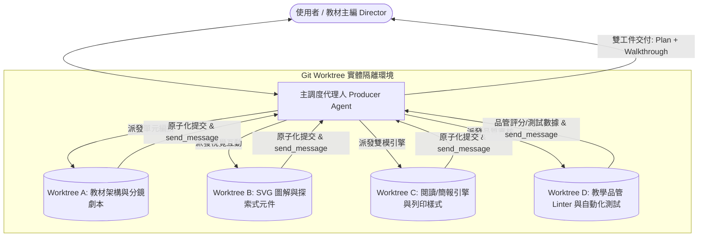

# 專案 AI 代理人蜂群協同與教材製作手冊 (AGENTS.md)
**Project AI Agent Swarm Protocol & Teaching Book Studio Playbook**

> **專案環境**：Windows (PowerShell) / Git `main`  
> **核心使命**：將教學內容打造成零依賴、可離線雙擊運行、兼具「教材閱讀模式」與「斷言-視覺證據簡報模式」的高可理解度互動書籍與簡報展示網站。

---

## 一、 蜂群協同與工作樹架構 (Swarm & Git Worktree Protocol)

當製作大型教學單元、跨章節互動元件或重構核心閱讀/簡報引擎時，嚴格落實「製作人—專家蜂群架構」：



### 1.1 製作人模式 (The Producer Pattern)
- **職責鎖定**：主調度代理人承擔「總製作人與教學系統架構師」職能：
  1. 拆解需求並擬定 `implementation_plan.md`。
  2. 先檢索 `.agents/memory/` 雙軌記憶庫（工程與編審雙軌），對齊用語與風格。
  3. 使用 `swarm` / `define_subagent` 配置專業子代理人，並在 Prompt 中明確指派領域規範與檔案邊界。
  4. 驗證整合結果並產出 `walkthrough.md`。
- **上下文隔離**：主代理人不將冗長的單元手稿與實作細節塞入主視窗，維持高層決策清晰度。

### 1.2 Git Worktree 實體隔離機制
- **並行防撞守則**：調度 2 位以上子代理人平行編碼或撰寫不同書籍單元時，必須為各子代理人建立獨立工作樹：
  ```powershell
  powershell -ExecutionPolicy Bypass -File .agents/skills/worktree-manager/scripts/worktree.ps1 -Action add -Branch feat/book-unit -Path ../wt-book-unit
  ```
- **路徑限制**：子代理人只能在指派的 Worktree 目錄內讀寫，嚴禁多名子代理人同時修改同一個工作樹。

### 1.3 非同步等待與喚醒協定 (Asynchronous Reactivity)
- 當觸發長程任務時，利用 `schedule` 工具或系統任務回調，**嚴禁調用 `Start-Sleep` 或無效輪詢迴圈**。
- 子代理人完成後必須回報變更檔案、測試輸出與 `npm run audit-books` 品管分數。

---

## 二、 絕對禁止與反偷懶鐵律 (Anti-Shortcut Mandate)

> [!CAUTION]
> **以下行為列為專案最高紅線，觸犯即視為嚴重失敗：**

1. **嚴禁假冒品管分數與寫死指標（No Fake Linter Scores）**
   - `pedagogyLinter.js` 必須動態解析每個單元的真實字數、視覺證據比例、詞彙連結與測驗解析，嚴禁回傳固定常數分數。
2. **嚴禁灌水填充空白頁（No Filler Text Padding）**
   - 簡報每頁僅放 1 個核心斷言與 2–4 個精要重點，詳細講解移入 `speakerNotes`；嚴禁為湊字數或版面而塞入無關裝飾圖或重複空話。
3. **嚴禁無證據圖解偽造或破壞實體素材（Preserve Real Diagrams & Facts）**
   - 教學中的數據、定義、公式與架構圖必須依據教材來源與 `curriculum_glossary.md` 實作；嚴禁虛構統計數據或用無關插圖取代真實視覺證據。
4. **依賴與測試誠實回報（Full Transparency）**
   - 所有測試、`audit-books` 分數、離線打包與瀏覽器檢查結果必須百分之百如實呈現，嚴禁隱匿警告或未執行即宣告通過。

---

## 三、 Windows 與終端環境防禦守則 (Windows Encoding Guard)

> [!IMPORTANT]
> 解決 Windows PowerShell 預設代碼頁 CP950 導致中文教材編譯或腳本輸出 `UnicodeEncodeError` 的黃金鐵律：

1. **指令前置 UTF-8 強制宣告**：
   ```powershell
   $env:PYTHONIOENCODING="utf-8"; chcp 65001 | Out-Null
   ```
2. **Python 腳本通用編碼頭部**：
   ```python
   import sys
   if hasattr(sys.stdout, 'reconfigure'):
       sys.stdout.reconfigure(encoding='utf-8')
   ```
3. **工作目錄絕對錨定**：
   - 每次調用 `run_command` 必須嚴格指定目標絕對路徑，嚴禁透過 `cd` 切換目錄造成狀態漂移。
4. **PowerShell 5.1 相容性**：
   - 專案 `.ps1` 腳本一律使用標準 `if (...) { ... } else { ... }`，嚴禁使用 PowerShell 7 專屬三元運算子 `? :`。

---

## 四、 工具精準調用黃金守則 (Precision Tooling Matrix)

| 工具 | 關鍵限制與黃金準則 | 違規痛點與防範措施 |
| :--- | :--- | :--- |
| **`edit_file`** | **微創手術原則（< 20 行）**<br>必須攜帶上下 2~3 行唯一識別代碼錨點。 | 避免大區塊縮排/換行差異失敗。若修改量超過 40% 或 80 行，**果斷轉向 `write_file` 整檔覆寫**。 |
| **`read_file`** | **精確範圍讀取（消除重複重讀）**<br>讀取前檢查上下文，精算 `StartLine` 與 `EndLine`。 | 消除無意義反覆讀取，節省 Context 空間。 |
| **`write_file`** | **大改寫與新單元初始化首選**<br>新書籍單元、規格工件或超過 40% 重構直接覆寫。 | 杜絕多處錨點替換失敗的循環重試。 |
| **`schedule`** | **非同步背景任務定時器**<br>搭配長時間運行任務使用，取代阻塞休眠。 | 避免主執行緒被無謂鎖死。 |

---

## 五、 驗證與交付閉環標準 (Verification & Dual-Artifact Standard)

任何新增教材、修改雙模引擎或調整技能，必須通過以下閉環驗證：

```text
[啟動任務] ──> 檢索雙軌記憶庫 & 產出 implementation_plan.md
                     │
                     ▼
          [蜂群 Worktree 隔離製作內容與元件]
                     │
                     ▼
          [npm test + npm run audit-books + npm run build]
                     │
                     ▼
          [verify.ps1 全棧衛生檢查 & 實機瀏覽器檢驗]
                     │
                     ▼
[完成任務] ──> 更新雙軌記憶 & 產出 walkthrough.md ──> [正式交付]
```

1. **開工工件**：`implementation_plan.md`（清楚記載教學目標、教材結構、技術方案與驗收方式）。
2. **竣工工件**：`walkthrough.md`（附實測數據、品管評分、可點擊檔案路徑與檢驗截圖/摘要）。
